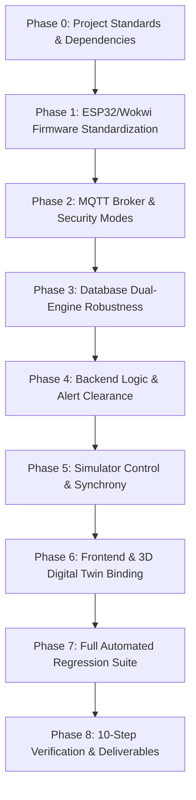

# KẾ HOẠCH TRIỂN KHAI VÀ HOÀN THIỆN HỆ THỐNG SMART SHOPPING CART IoT
**Dự án:** Smart Shopping Cart – Hệ thống xe đẩy hàng thông minh ứng dụng IoT  
**Môi trường:** Python 3.13 / PlatformIO Core 6.2.0 (Windows)  
**Tài liệu tham chiếu:** `IOT_PROJECT_AUDIT_REPORT.md`, `evidence/chapter_4/EVIDENCE_GAPS.md`

---

## 1. NGUYÊN TẮC VÀ PHẠM VI DỰ ÁN

Hệ thống được thiết kế và triển khai theo mô hình **Digital Twin & Virtual Hardware Prototype (Phần cứng ảo hóa)** phục vụ đồ án môn học IoT:
- **Tập trung cốt lõi:** Luồng dữ liệu hai chiều đầu-cuối qua MQTT, kiến trúc Backend hướng sự kiện, máy trạng thái giỏ hàng, thuật toán bảo vệ chống gian lận trọng lượng và giám sát trực quan 3D.
- **Ranh giới trung thực:** Không tuyên bố đã chế tạo phần cứng vật lý hay triển khai production Docker khi môi trường chạy cục bộ sử dụng SQLite và `dev_broker.py`. Mọi hạng mục phải phản ánh đúng bằng chứng kỹ thuật.

---

## 2. PHÂN LOẠI CÁC HẠNG MỤC CẦN TRIỂN KHAI VÀ GIỚI HẠN KỸ THUẬT

### A. IMPLEMENTABLE (Triển khai trực tiếp trong Phases 0 – 8)
1. **Chuẩn hóa ESP32/Wokwi Firmware & Cầu nối Serial:**
   - Đảm bảo 100% khớp schema MQTT Contract (`shared/contract.py`): topic structure, envelope metadata (`message_id`, `timestamp`, `cart_id`), định dạng payload ACK (`command_id`, `result`, `message`).
   - Tối ưu hóa logic kết nối lại (reconnect backoff), nhịp phát heartbeat (5s), telemetry (10s).
   - Kiểm chứng biên dịch thành công cho cả 3 target PlatformIO: `esp32dev_sim`, `esp32dev_sim_bridge`, `esp32dev_standalone`.
2. **Chuẩn hóa MQTT Broker & Phân định chế độ bảo mật:**
   - Phân định rõ ràng 2 chế độ vận hành: **Chế độ phát triển (Development Mode)** trên cổng 1883 (plaintext, zero-config) và **Chế độ bảo mật cao (Secure Mode)** trên cổng 8883 (TLS, ACL, HMAC-SHA256).
   - Ghi log minh bạch tại thời điểm khởi động broker/backend về chế độ bảo mật đang kích hoạt.
3. **Tối ưu hóa tầng dữ liệu (Dual-Engine Database & ORM):**
   - Bổ sung cấu hình `connect_timeout` (3 giây) cho kết nối PostgreSQL trong `backend/database/db.py` để tránh hiện tượng treo ứng dụng (hanging) khi PostgreSQL không chạy.
   - Kiểm tra và tự động khởi tạo/xác thực schema SQLite khi Backend khởi động.
4. **Nâng cao độ tin cậy Backend:**
   - Ràng buộc phiên mua hàng: kiểm tra trạng thái xe (chỉ cho phép thao tác khi xe ở trạng thái hợp lệ).
   - Xử lý mượt mà cảnh báo chênh lệch trọng lượng (`WEIGHT_MISMATCH`), tự động xóa cảnh báo khi trọng lượng khớp.
   - Xử lý lệnh điều khiển và ACK hai chiều bất đồng bộ.
5. **Python Smart Cart Simulator & Tích hợp 3D Digital Twin:**
   - Đảm bảo API điều khiển simulator và WebSocket đồng bộ trạng thái xe tức thời.
   - Ràng buộc di chuyển trong không gian 3D: chỉ cho phép xe di chuyển khi phiên mua đang mở.
   - Sửa triệt để lỗi chọn xe điều khiển trong giao diện 3D.
6. **Hệ thống kiểm thử tự động & Kịch bản thực nghiệm:**
   - Bảo toàn 142 bài test PASSED hiện có; không để xảy ra bất kỳ hồi quy (regression) nào.
   - Chạy và ghi nhận chi tiết kịch bản demo 10 bước (từ khởi động offline -> quét hàng -> phát hiện gian lận -> checkout -> xe trở về bãi).

---

### B. ENVIRONMENT BLOCKED (Giới hạn môi trường máy trạm)
1. **16 bài kiểm thử phụ thuộc `g++` host:**
   - *Nguyên nhân:* Môi trường Windows hiện tại không cài đặt trình biên dịch native GCC/G++ trong PATH (`where.exe cl clang gcc g++` trả về mã lỗi 1).
   - *Ảnh hưởng:* 16 test trong pytest (`test_firmware_protocol.py` [8], `test_wokwi_package.py` [7], `test_wokwi_bridge.py` [1]) dùng subprocess gọi `g++` để biên dịch `protocol_tool.cpp` trên máy tính cá nhân.
   - *Giải pháp thay thế đã xác minh:* PlatformIO Core 6.2.0 có sẵn toolchain `xtensa-esp32-elf-g++` đã biên dịch thành công 100% firmware nhị phân thực tế cho ESP32.
2. **PostgreSQL và Mosquitto chạy trên Docker Engine:**
   - *Nguyên nhân:* Dịch vụ Docker Desktop / Docker daemon không chạy trên máy phát triển cục bộ.
   - *Ảnh hưởng:* Không thể khởi chạy container PostgreSQL 16 và Eclipse Mosquitto runtime thật.
   - *Giải pháp thay thế đã xác minh:* Cấu hình Docker (`docker-compose.yml`, `mosquitto/`) đã hoàn thiện; tầng trừu tượng Dual-Engine đã vượt qua unit test cú pháp SQL và chuyển đổi kiểu dữ liệu.

---

### C. HARDWARE BLOCKED (Giới hạn phần cứng vật lý)
1. **Mạch vi điều khiển và cảm biến vật lý:**
   - Không có board ESP32 thật, cảm biến loadcell HX711 thật, đầu đọc barcode UART/RC522 thật và khung xe cơ khí.
   - *Định vị kỹ thuật:* Toàn bộ được hiện thực hóa qua Virtual Hardware Prototype (Wokwi simulation + Python Smart Cart Simulator), giải quyết trọn vẹn thuật toán và giao thức IoT.

---

### D. WOKWI LIMITATION (Giới hạn nền tảng Wokwi Web)
1. **Kết nối mạng ra Broker cục bộ từ Wokwi Free Tier:**
   - Wokwi web chạy trong sandbox trình duyệt không thể trực tiếp mở socket TCP tới `127.0.0.1:1883` của máy người dùng nếu không dùng Wokwi IoT Gateway hoặc public broker có TLS.
   - *Giải pháp của dự án:* Đã xây dựng cầu nối Serial RFC2217 qua TCP (`tools/wokwi_bridge.py`) kết nối với firmware target `esp32dev_sim_bridge`.

---

### E. NOT REQUIRED (Nằm ngoài phạm vi đồ án môn học)
1. **Tích hợp cổng thanh toán trực tuyến của ngân hàng thật:** Thanh toán mô phỏng thành công qua giao diện POS / màn hình giỏ hàng của khách hàng.
2. **Cảm biến định vị trong nhà vật lý (UWB/LiDAR):** Trực quan hóa vị trí qua hệ thống Waypoint của 3D Digital Twin đã đáp ứng đầy đủ yêu cầu trình diễn trực quan.

---

## 3. LỘ TRÌNH THỰC HIỆN CHI TIẾT (PHASES 0 – 8)

| Phase | Mục tiêu chính | File bị ảnh hưởng | Tiêu chí hoàn thành (DoD) |
|---|---|---|---|
| **Phase 0** | Rà soát cấu hình, biến môi trường, bảo toàn working tree | `.env.example`, `requirements.txt` | Không lỗi syntax, dependencies sẵn sàng |
| **Phase 1** | Chuẩn hóa Contract cho firmware ESP32, kiểm tra ACK schema | `firmware/src/main.cpp`, `firmware/lib/cartcore/*` | Build thành công 3 target PlatformIO không cảnh báo |
| **Phase 2** | Chuẩn hóa phân định Development Mode vs Secure Mode | `tools/dev_broker.py`, `backend/mqtt/gateway.py` | Log khởi động minh bạch, xử lý lỗi kết nối an toàn |
| **Phase 3** | Tối ưu kết nối PostgreSQL và kiểm tra toàn vẹn SQLite | `backend/database/db.py` | Thêm `connect_timeout=3` tránh treo khi test/fail |
| **Phase 4** | Củng cố Backend logic: ràng buộc phiên, giải tỏa cảnh báo | `backend/services/*`, `backend/routes/*` | Cảnh báo tự xóa khi cân khớp, chặn thao tác sai phiên |
| **Phase 5** | Đồng bộ Simulator API và trạng thái xe đa phiên | `simulator/main.py`, `simulator/cart.py` | Trạng thái xe khớp tuyệt đối giữa Simulator và Backend |
| **Phase 6** | Hoàn thiện Frontend & Ràng buộc di chuyển 3D Digital Twin | `frontend/static/js/*` | Xe chỉ di chuyển khi có phiên; chọn xe chuẩn xác |
| **Phase 7** | Chạy kiểm thử tự động toàn bộ hệ thống | `tests/unit/`, `tests/integration/`, `tests/e2e/` | Đạt 142 PASSED, 0 FAILED, giải trình 16 SKIPPED |
| **Phase 8** | Chạy kiểm chứng kịch bản thực nghiệm 10 bước | Kịch bản 10 bước thực nghiệm | Hoàn thành đủ 10 bước; xuất 4 báo cáo tổng kết |

---

## 4. QUẢN TRỊ RỦI RO

1. **Rủi ro hồi quy (Regression):** Mọi chỉnh sửa mã nguồn phải được kiểm tra lại ngay bằng các test tương ứng (`pytest tests/unit/`, `pytest tests/integration/`).
2. **Rủi ro thất thoát dữ liệu:** Tuyệt đối không xóa hoặc ghi đè file `data/smartcart.db` hiện hữu.
3. **Rủi ro môi trường:** Khóa chặt các tương tác yêu cầu Docker hoặc `g++` host thành thông tin giải trình kỹ thuật minh bạch, không cố gắng tạo workaround giả mạo.
