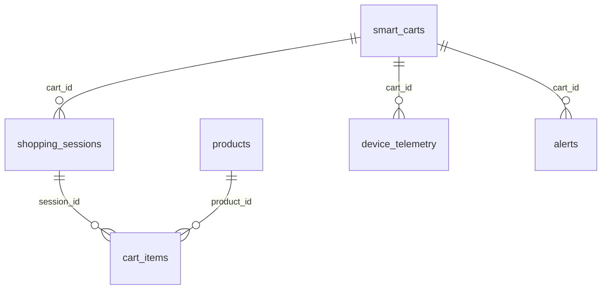

# Cơ sở dữ liệu

SQLite (mặc định, `DB_PATH`), 6 bảng, định nghĩa ở `backend/database/schema.sql`. Dữ liệu mẫu: `data/products_seed.json` (15 sản phẩm), `data/carts_seed.json` (CART_001…003), nạp idempotent khi khởi động (`SEED_ON_START=1`).

| Bảng | Cột chính | Ràng buộc / ghi chú |
|---|---|---|
| `products` | id, barcode, name, price (VND, INTEGER), unit_weight (g), image, active | `barcode` UNIQUE |
| `smart_carts` | cart_id (PK), name, cart_status, connection_status, battery_percent, current_weight (g), last_seen, created_at, updated_at | CHECK trên 2 trạng thái |
| `shopping_sessions` | id, cart_id, status (`ACTIVE/COMPLETED`), started_at, ended_at, total_amount, note | **tối đa 1 phiên ACTIVE/xe** (unique index một phần). Thông tin hoá đơn nằm ở đây – không có bảng `orders` |
| `cart_items` | id, session_id, product_id, quantity, unit_price | `UNIQUE(session_id, product_id)`; `unit_price` = giá chụp lúc thêm |
| `device_telemetry` | id, cart_id, battery_percent, actual_weight, cart_status, timestamp, created_at | giữ tối đa 5000 dòng/xe (`TELEMETRY_KEEP_PER_CART`) |
| `alerts` | id, cart_id, alert_type, status (`ACTIVE/RESOLVED`), detail, created_at, resolved_at | **không trùng cảnh báo ACTIVE cùng loại cho cùng xe** (unique index một phần) |

Giao dịch: `Database.tx()` (BEGIN IMMEDIATE / COMMIT / ROLLBACK, lồng nhau được); `checkout` và mọi thay đổi giỏ hàng chạy trong giao dịch (có test rollback).
Một connection dùng chung + `RLock`; WAL khi dùng file.

## Chuyển sang PostgreSQL (chưa thực hiện)

Đề cương dự kiến PostgreSQL; bản này dùng SQLite vì môi trường build không cài được driver. Việc cần làm:
1. `schema.sql`: `INTEGER PRIMARY KEY AUTOINCREMENT` → `GENERATED ALWAYS AS IDENTITY`; `REAL` → `DOUBLE PRECISION`; `active INTEGER` → `BOOLEAN`; TEXT thời gian → `TIMESTAMPTZ`; unique index một phần giữ nguyên cú pháp.
2. `backend/database/db.py`: viết lại class `Database` (cùng interface `one/all/insert/execute/tx`) bằng psycopg + connection pool; đổi placeholder `?` → `%s`, `lastrowid` → `RETURNING id`.
3. Thay `SELECT ... LIMIT`/`DELETE ... <= (SELECT MAX..)-?` nếu cần; kiểm lại `IN_TRANSACTION` logic của `tx()`.
