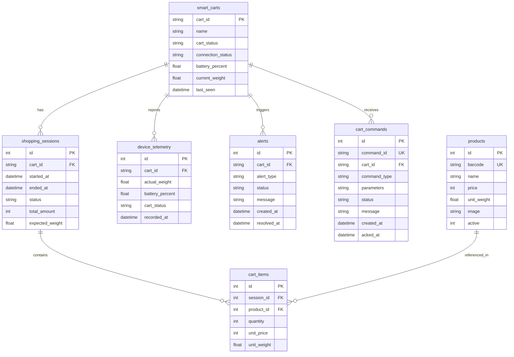

# Tài Liệu Ôn Tập & Làm Chủ Kiến Thức Thuyết Trình (Study Guide)

Tài liệu này tổng hợp toàn bộ kiến thức kỹ thuật từ **Nhóm A đến Nhóm H** cần nắm vững để thuyết trình và trả lời vấn đáp bảo vệ đồ án **Smart Shopping Cart**. Mọi ví dụ đều trích trực tiếp từ source code thực tế của project sau khi hoàn thiện toàn bộ các hạng mục Technical Audit.

---

## Nhóm A — Kiến Thức Tổng Quan IoT

### 1. IoT là gì và bài toán trong Smart Shopping Cart?
- **IoT (Internet of Things)** là mạng lưới các thiết bị vật lý nhúng cảm biến, bộ xử lý và module truyền thông để thu thập dữ liệu, trao đổi qua mạng và thực hiện hành động điều khiển tự động hoặc từ xa.
- Trong **Smart Shopping Cart**, mỗi xe đẩy đóng vai trò một **IoT Edge Node** (trong project được mô phỏng bởi `simulator/cart/__init__.py` và viết firmware C++ cho ESP32 ở `firmware/src/main.cpp`), kết nối về **IoT Platform / Backend** qua giao thức **MQTT** để đồng bộ giỏ hàng, giám sát cân nặng/pin/trạng thái online và nhận lệnh khoá xe.

### 2. Mô hình kiến trúc IoT 5 tầng áp dụng trong project

| Tầng kiến trúc | Vai trò lý thuyết | Hiện thực trong source code |
|---|---|---|
| **1. Perception (Cảm biến & Cơ cấu chấp hành)** | Thu thập tín hiệu vật lý (mã vạch, khối lượng, điện áp pin, nút bấm) và phát tín hiệu (LED, còi, OLED) | Mô phỏng trong `SmartCart` (`simulator/cart/__init__.py`: `measured_weight()` nhiễu Gauss `3g`, `battery` tụt `0.2%/phút`) và định nghĩa chân phần cứng ở `firmware/include/pins.h` + `firmware/diagram.json` (UART GM65, HX711, ADC1 pin, SSD1306, buzzer, 2 LED, 2 nút). |
| **2. Edge Processing (Xử lý biên)** | Lọc nhiễu, chuẩn hoá dữ liệu, kiểm tra điều kiện cục bộ trước khi gửi lên mạng | `firmware/lib/cartcore/cartcore.cpp`: `WeightFilter` (lọc trung vị 5 mẫu + làm mượt EMA `alpha=0.4`, deadband `<1g`), `normalize_barcode()`, `LowBatteryMonitor` (hysteresis `<20%` bật, `>=25%` tắt), `CartLogic` (state machine + cache `command_id` idempotent). Hàng đợi ngoại tuyến `offline_queue` trên Simulator. |
| **3. Network / Transport (Truyền thông)** | Vận chuyển gói tin nhẹ, tin cậy giữa thiết bị và server | `shared/mqttlite.py` (MQTT 3.1.1 trên TCP/TLS 1.2+), `PubSubClient` / `WiFiClientSecure` trong firmware, và `tools/wokwi_bridge.py` (cầu nối Serial TCP/RFC2217 cổng 4000 ↔ MQTT). |
| **4. Platform / Middleware (Backend & Broker)** | Định tuyến message, xác thực, xử lý nghiệp vụ, luật cảnh báo và lưu trữ bền vững | Mosquitto (hoặc `tools/dev_broker.py`), `backend/mqtt/gateway.py`, `backend/services/*`, `backend/alerts/rules.py`, `backend/database/db.py` (Dual-Engine PostgreSQL 16 & SQLite WAL). |
| **5. Application (Ứng dụng đầu cuối)** | Giao diện tương tác cho khách hàng, quản trị viên và điều khiển giả lập | `frontend/src/` (React 19): `/customer`, `/admin`, `/simulator`, cập nhật realtime qua REST (`:8000`) và WebSocket (`/ws` trên `:8000`). |

### 3. Luồng dữ liệu & Lý do chọn kiến trúc hướng sự kiện (Event-Driven + Pub/Sub)
- **Luồng dữ liệu:** Thiết bị phát `scan` / `telemetry` / `heartbeat` qua MQTT → Broker → `Gateway.on_message()` kiểm tra chữ ký HMAC, schema, chống trùng → `ingest.handle()` cập nhật CSDL (PostgreSQL/SQLite) & kích hoạt Alert Engine → `Hub.publish()` đẩy sự kiện qua WebSocket `/ws` → UI tự cập nhật không cần reload trang.
- **Vì sao chọn MQTT + REST + WebSocket thay vì chỉ dùng HTTP Polling?**
  1. **Tách rời (Decoupling):** Xe không cần biết địa chỉ IP/API của từng màn hình UI; chỉ cần kết nối Broker.
  2. **Nhẹ cho thiết bị nhúng:** Header MQTT tối thiểu 2 byte, phù hợp ESP32 băng thông thấp.
  3. **Realtime 2 chiều:** MQTT hỗ trợ đẩy lệnh `LOCK_CART` xuống xe tức thì; WebSocket đẩy cập nhật lên UI tức thì mà không tốn băng thông polling liên tục.

---

## Nhóm B — ESP32 và Mô Phỏng (PlatformIO & Wokwi)

### 1. ESP32 & Firmware trong project
- **ESP32 (DevKit V1)** là vi điều khiển SoC tích hợp Wi-Fi/Bluetooth, 2 nhân Xtensa, hỗ trợ UART, I2C, SPI, ADC, NVS Flash.
- **Vai trò firmware (`firmware/`):** Đọc mã vạch UART, cân HX711, đo pin ADC, điều khiển OLED/LED/còi, đóng gói JSON đúng `MQTT_CONTRACT.md`, ký HMAC-SHA256 và thực thi 4 lệnh từ Backend. **Lưu ý:** Thanh toán **không** nằm trên ESP32 mà thực hiện trên Customer Web.

### 2. Sơ đồ GPIO & Ngoại vi mô phỏng (`firmware/include/pins.h` & `firmware/diagram.json`)

| Ngoại vi | Giao thức | Chân ESP32 | Vai trò trong `src/main.cpp` |
|---|---|---|---|
| **Máy quét GM65/GM66/GM861** | UART2 (`9600 8N1`) | `GPIO16` (RX2), `GPIO17` (TX2) | `scanner_poll()` gom byte qua `LineAssembler` (timeout 80ms) → `normalize_barcode()` (`4..64` ký tự `[0-9A-Za-z-]`). |
| **Load Cell + HX711** | 2-wire serial | `GPIO32` (DT), `GPIO33` (SCK) | `weight_poll()` lấy mẫu 100ms/lần → `WeightFilter` (median 5 + EMA). |
| **OLED SSD1306 (128×64)** | I2C (`0x3C`, `400kHz`) | `GPIO21` (SDA), `GPIO22` (SCL) | `display_update()` (250ms/lần) hiển thị `CART_ID`, trạng thái, cân, pin, phiên, splash `"CAM ON!"`. |
| **Active Buzzer** | Digital OUT | `GPIO25` | `beep()` + `buzzer_update()` phát mẫu kêu không chặn (`PAT_OK`, `PAT_ERROR`, `PAT_LOCK`, `PAT_THANKS`). |
| **LED Xanh / Đỏ** | Digital OUT (qua trở `330Ω`) | `GPIO26` (Xanh), `GPIO27` (Đỏ) | Xanh sáng = sẵn sàng, xanh nháy = đang nối mạng; Đỏ sáng = `LOCKED`, đỏ nháy = pin yếu. |
| **Nút MODE / TARE** | Digital IN (`INPUT_PULLUP`) | `GPIO13` (MODE), `GPIO14` (TARE) | MODE bấm ngắn: đổi `ADD ↔ REMOVE` cho 1 lần quét; TARE giữ `2s`: về 0 cân (chỉ khi không có phiên). |
| **Đo pin LiPo 1S** | ADC1 (`ADC_11db`) | `GPIO34` | Qua cầu chia áp `100k/100k` (`ratio=2.0`); **tránh dùng ADC2** vì xung đột với Wi-Fi trên ESP32. |

### 3. Tách lớp `lib/cartcore` vs `src/main.cpp`
- **`firmware/lib/cartcore/`** (`cartcore.h`, `cartcore.cpp`, `cartsec.h`, `cartsec.cpp`): Viết bằng **C++11 thuần**, **không** `#include <Arduino.h>`. Nhờ vậy biên dịch và chạy được unit test ngay trên PC (`env:native` hoặc `g++` + ASan/UBSan) và chạy công cụ kiểm tra chéo `protocol_tool.cpp` với Python (`test_firmware_protocol.py`).
- **`firmware/src/main.cpp`**: Là lớp glue code với phần cứng & mạng, dùng vòng lặp **non-blocking** (`Interval::due(now)` dựa trên `millis()`, không dùng `delay()` trong `loop()`).

### 4. PlatformIO & 3 chế độ mô phỏng Wokwi (`firmware/platformio.ini`, `wokwi.toml`)
- **PlatformIO** quản lý toolchain `espressif32`, thư viện (`PubSubClient@^2.8`, `HX711@^0.7.5`, `Adafruit SSD1306@^2.5.9`, `Adafruit GFX@^1.11.9`) và các build environment:
  1. `esp32dev_sim` / `esp32dev_standalone` (`STANDALONE_MODE=1`): Chạy độc lập trong Wokwi/board, không Wi-Fi/MQTT, in gói `[local] ...` ra Serial. Build thành công 100% trong 41.96s.
  2. `esp32dev_wokwi_online` (`WOKWI_ONLINE=1`): Nối Wi-Fi ảo `Wokwi-GUEST` tới broker công cộng (`broker.hivemq.com:1883`) với `MQTT_TOPIC_ROOT` riêng trong `include/wokwi_online.h`.
  3. `esp32dev_sim_bridge` (`STANDALONE_MODE=1`, `SERIAL_BRIDGE=1`): Wokwi mở Serial ra cổng TCP `4000` (`rfc2217ServerPort = 4000` trong `wokwi.toml`); `tools/wokwi_bridge.py` chuyển tiếp Serial ↔ MQTT. Build thành công 100% trong 62.54s.
- **Ranh giới mô phỏng vs phần cứng thật:** Dự án tập trung vào kiểm chứng kiến trúc phần mềm và firmware mô phỏng; dữ liệu cân/pin trong demo đều là dữ liệu mô phỏng, không gắn cảm biến vật lý.

---

## Nhóm C — MQTT và Giao Tiếp Thiết Bị

### 1. Tổng quan MQTT trong `shared/mqttlite.py` & `tools/dev_broker.py`
- **Publisher / Subscriber / Broker:** Xe publish lên `smartcart/{cart_id}/{scan|event|telemetry|heartbeat|ack}` và subscribe `smartcart/{cart_id}/command`. Backend subscribe wildcard `smartcart/+/{scan,event,telemetry,heartbeat,ack}` và publish `smartcart/{cart_id}/command`.
- **QoS 0 và cơ chế bù đắp tầng ứng dụng:**
  - `shared/mqttlite.py` sử dụng QoS 0 để tối ưu tốc độ và không phụ thuộc thư viện ngoài.
  - Bù đắp độ tin cậy bằng: **Offline Queue** trên thiết bị (lưu sự kiện quét khi mất mạng, tự gửi bù khi có mạng), cơ chế **Command + ACK** (chờ 5s), và **Deduplication** trên Backend bằng `scan_id` để loại bỏ duplicate.
- **Thay thế Retained & LWT:**
  - Thay cho Retained: Khi xe nối lại (`OFFLINE → ONLINE`), Backend gọi `_reconcile()` gửi lại trạng thái chuẩn (`LOCK_CART` / `START_SESSION` / `END_SESSION`).
  - Thay cho LWT: Xe gửi `heartbeat` mỗi 5s; `HeartbeatMonitor` quét mỗi 2s phát hiện mất tin > 15s để chuyển `OFFLINE`.

### 2. Chuẩn 6 Topic & JSON Envelope (`shared/contract.py`)
Mọi message tuân thủ envelope thống nhất (`schema_version = 1`):
```json
{
  "message_id": "6f1c2a9e-0f4e-4a43-9b6f-1d6f2a7c8e10",
  "cart_id": "CART_001",
  "schema_version": 1,
  "timestamp": "2026-11-07T10:30:00Z",
  "sig": "<64 hex HMAC-SHA256 nếu bật DEVICE_MASTER_KEY>",
  "data": { ... }
}
```
- `smartcart/{cart_id}/scan`: `{"scan_id": "uuid", "barcode": "8934588012341", "action": "ADD|REMOVE"}`
- `smartcart/{cart_id}/telemetry`: `{"actual_weight": 847.0, "battery_percent": 82.5, "cart_status": "IN_USE", "wifi_status": "CONNECTED", "mqtt_status": "CONNECTED"}`
- `smartcart/{cart_id}/heartbeat`: `{"uptime_s": 1234, "cart_status": "AVAILABLE"}`
- `smartcart/{cart_id}/event`: `{"event_type": "UNKNOWN_BARCODE|CART_LOCKED|CART_UNLOCKED|SCAN_REJECTED", "description": "..."}`
- `smartcart/{cart_id}/command`: `{"command_id": "uuid", "command_type": "LOCK_CART|UNLOCK_CART|START_SESSION|END_SESSION", "parameters": {...}}`
- `smartcart/{cart_id}/ack`: `{"command_id": "uuid", "result": "OK|FAILED", "message": "Đã khoá xe"}`

### 3. Xử lý mất kết nối, Offline Queue & Chống trùng
- **Reconnect:** `MqttClient._run()` tự kết nối lại với **exponential backoff** `0.5s → 1s → 2s → 4s → 8s` và tự gửi lại gói `SUBSCRIBE`.
- **Offline Queue (trên Simulator):** `SmartCart.scan()` (`simulator/cart/__init__.py`) có hàng đợi `offline_queue` (FIFO, tối đa `50` bản ghi); khi nối lại mạng `_on_connected()` tự động gọi `drain_offline_queue()` gửi bù lần lượt kèm `scan_id` gốc với giãn cách 50ms.
- **Chống xử lý trùng:**
  - Tại `Gateway.on_message()`: `ctx.dedupe.seen(f"msg:{env['message_id']}")` (LRU cache tối đa `2000` phần tử).
  - Tại `ingest._scan()`: `ctx.dedupe.seen(f"scan:{cart_id}:{scan_id}")` chống trùng sự kiện quét.

---

## Nhóm D — Backend và Xử Lý Nghiệp Vụ

### 1. Khung ứng dụng FastAPI
- Backend khởi tạo qua `FastAPI` trong `backend/api/app.py`, tự động sinh Swagger UI tại `/docs` và ReDoc tại `/redoc`.
- Duy trì các route `/api/docs` và `/api/openapi.json` tương thích ngược.
- 26 endpoints REST được phân chia theo module rõ ràng: System, Products, Carts, Sessions, Alerts, Commands, Auth.

### 2. Các nghiệp vụ cốt lõi
1. **Quản lý phiên mua sắm (Shopping Sessions):**
   - Bắt đầu phiên (`POST /api/sessions`): Xe phải `ONLINE` và `AVAILABLE`. Backend chuyển xe sang `IN_USE` và gửi lệnh MQTT `START_SESSION` xuống xe.
   - Ràng buộc: Mỗi xe chỉ có duy nhất 1 phiên `ACTIVE` tại một thời điểm (được bảo vệ bằng partial unique index trong CSDL).
2. **Quản lý giỏ hàng & Price Snapshot:**
   - Khi quét mã (`ingest._scan`): Tra cứu giá và cân nặng đơn vị từ bảng `products`.
   - Lưu vào `cart_items` với đơn giá `unit_price` chốt tại thời điểm mua (Price Snapshot). Nếu sau này admin đổi giá sản phẩm trong danh mục, giá trong giỏ của phiên đang mua không bị thay đổi.
3. **Thanh toán nguyên tử (Atomic Checkout):**
   - Thực hiện qua transaction `with db.tx():`.
   - Cập nhật phiên sang `COMPLETED`, tính toán lại tổng tiền, giải phóng xe về `AVAILABLE`, đóng các cảnh báo liên quan, và gửi lệnh MQTT `END_SESSION` xuống xe để xóa giỏ hàng trên thiết bị. Nếu có lỗi giữa chừng, toàn bộ thay đổi được rollback tự động.
4. **Quản lý lệnh điều khiển (Cart Commands):**
   - Khi admin khoá xe (`POST /api/carts/{id}/lock`): Ghi nhận lệnh vào bảng `cart_commands` với trạng thái `PENDING`, gửi MQTT `LOCK_CART` và đợi ACK (tối đa 5s).
   - Khi nhận ACK `OK`: Cập nhật `cart_commands` thành `OK` và cập nhật xe sang `LOCKED`.
   - Lưu trữ bền vững trong CSDL, tra cứu lịch sử qua `GET /api/commands`.

---

## Nhóm E — Database (Dual-Engine PostgreSQL 16 & SQLite)

### 1. Kiến trúc Dual-Engine
- Hỗ trợ cả 2 hệ quản trị CSDL qua lớp trừu tượng `Database` trong `backend/database/db.py`:
  - **PostgreSQL 16:** Sử dụng driver `psycopg` 3.3.9, phù hợp môi trường Production/Docker container. Hỗ trợ câu lệnh SQL chuẩn PostgreSQL (`RETURNING id`, `psycopg.Connection.transaction()`).
  - **SQLite (WAL mode):** Phù hợp môi trường kiểm thử tự động, chạy cục bộ nhanh không cần cài đặt server CSDL.
- Chuyển đổi linh hoạt qua biến môi trường `DB_BACKEND=postgres` hoặc `DB_BACKEND=sqlite`.

### 2. Sơ đồ ERD & 7 Bảng Dữ Liệu



---

## Nhóm F — Frontend và Giao Diện

### 1. Kiến trúc Frontend
- Xây dựng bằng **React 19**, đóng gói siêu nhanh bằng **esbuild** (`frontend/build.mjs`), không dùng thư viện ngoài nặng nề.
- 3 phân hệ giao diện:
  1. `/customer`: Giao diện khách hàng chọn xe, xem giỏ hàng realtime, xem cảnh báo lệch cân và xác nhận thanh toán.
  2. `/admin`: Dashboard quản trị viên giám sát trạng thái 3 xe, danh sách cảnh báo, chi tiết telemetry biểu đồ pin/cân SVG và nút khoá/mở khoá xe từ xa.
  3. `/simulator`: Bảng điều khiển giả lập phần cứng (quét mã, sụt pin, tăng giảm trọng lượng, ngắt kết nối mạng).

### 2. Kênh truyền thông Realtime
- Kết nối WebSocket trực tiếp vào FastAPI tại endpoint `/ws` trên cổng 8000.
- Khách hàng đăng nhập hoặc gửi token phiên qua tin nhắn `AUTH` để nhận dữ liệu giỏ hàng riêng; Admin nhận toàn bộ sự kiện hệ thống.
- Cơ chế Fallback Polling 5s tự động kích hoạt nếu kết nối WebSocket bị gián đoạn.

---

## Nhóm G — Docker và Triển Khai

### 1. Docker Compose
Tệp `docker-compose.yml` gồm 4 services chính:
- `postgres`: Image `postgres:16-alpine`, cổng `5432:5432`, volume `postgres-data`, healthcheck `pg_isready`.
- `mqtt-broker`: Image `eclipse-mosquitto:2`, cổng `1883:1883` và `9001:9001` (WebSocket).
- `backend`: Build từ `backend/Dockerfile` multi-stage (Node 22 build frontend -> Python 3.12 runtime), cổng `8000:8000` và `8081:8081`, phụ thuộc `postgres` (healthy) và `mqtt-broker`.
- `simulator`: Build từ `simulator/Dockerfile`, cổng `8090:8090`, kết nối vào `mqtt-broker`.

### 2. Script khởi chạy Windows PowerShell
- Tệp [scripts/run_local.ps1](file:///d:/Filehoc/IOT/smart-shopping-cart/smart-shopping-cart/scripts/run_local.ps1) giúp chạy toàn bộ hệ thống trên Windows chỉ bằng 1 lệnh:
  - Kiểm tra dependency Python và packages.
  - Tự động giải phóng các cổng 8000, 8081, 8090 nếu bị chiếm dụng.
  - Khởi động Broker, Backend FastAPI và Simulator theo thứ tự.
  - Bắt tín hiệu `Ctrl + C` để tắt sạch tất cả tiến trình con.

---

## Nhóm H — Kiểm Thử và Độ Tin Cậy

### 1. Ma trận kiểm thử toàn diện
Hệ thống sở hữu bộ kiểm thử tự động gồm **131 tests PASS**:
- **Unit Tests (47 PASS):** Kiểm tra hợp đồng MQTT 6 topic, logic rule engine, các service CSDL, tính nguyên tử của checkout, logic giải mã telnet bridge và kiểm tra tĩnh gói Wokwi.
- **Integration Tests (64 PASS):** Kiểm tra vòng đời mua sắm end-to-end, phục hồi mất mạng, bảo mật chữ ký HMAC, chống replay attack, quyền RBAC, và **bộ test nâng cấp `test_enhancements.py`** (Offline queue recovery, command persistence qua restart, unified FastAPI websocket).
- **E2E Browser Tests (20 PASS):** Sử dụng Playwright Chromium kiểm chứng toàn bộ hành trình người dùng trên Customer UI, Admin Dashboard, quy trình đăng nhập và bảng điều khiển Simulator.
- **Firmware Build Verification:** Biên dịch PlatformIO 100% SUCCESS cho cả 2 target `esp32dev_sim` và `esp32dev_sim_bridge`.
