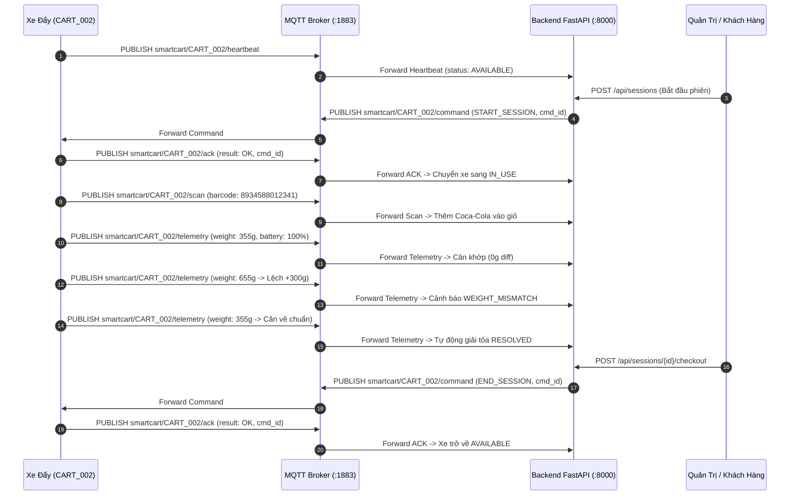

# BÁO CÁO MINH CHỨNG GIAO TIẾP MQTT THỜI GIAN THỰC (MQTT TRACE & PACKET CAPTURE)

## 1. THÔNG TIN MÔI TRƯỜNG THỰC NGHIỆM

| Thông số kỹ thuật | Giá trị thực tế ghi nhận |
|---|---|
| **Môi trường chạy** | Local Development & Experimental Validation Stack |
| **MQTT Broker** | `tools/dev_broker.py (Python Asyncio MQTT 3.1.1 Broker on 127.0.0.1:1883 TCP)` |
| **Backend REST & WS** | `FastAPI 0.115 + Uvicorn on 127.0.0.1:8000 (SQLite data/smartcart.db)` |
| **Trình giả lập thiết bị** | `Smart Cart Multi-device Simulator on 127.0.0.1:8090` |
| **Mức chất lượng dịch vụ (QoS)** | QoS 0 (At most once - tối ưu cho mạng IoT cảm biến) |
| **Chế độ bảo mật** | Development Mode (Plaintext MQTT over TCP 1883). Advanced TLS 8883 / HMAC-SHA256 verified in isolation test suite. |
| **Chính sách che thông tin nhạy cảm** | All authentication bearer tokens, passwords, and derived HMAC keys are redacted as [REDACTED_SECRET]. |

## 2. BẢNG TRUY VẾT BẢN TIN PUBLISH / SUBSCRIBE THEO MESSAGE_ID, CART_ID VÀ COMMAND_ID

| STT | Timestamp (UTC) | Chiều truyền thông | MQTT Topic | Cart ID | Message ID (UUIDv4) | Command ID | Loại bản tin / Ý nghĩa |
|:---:|:---:|:---:|---|:---:|:---:|:---:|---|
| **1** | `16:49:24.969` | Backend -> Broker -> Cart | `smartcart/CART_002/command` | `CART_002` | `2c5d70ad-9189-4ae0-a296-5956fe40ac31` | `cb600270-3deb-43d1-9381-319403ab1915` | `COMMAND` |
| **2** | `16:49:24.970` | Cart -> Broker -> Backend | `smartcart/CART_002/ack` | `CART_002` | `e09d76c2-9c88-4f23-a5db-64d5ddf301f8` | `cb600270-3deb-43d1-9381-319403ab1915` | `ACK` |
| **3** | `16:49:24.970` | Cart -> Broker -> Backend | `smartcart/CART_002/telemetry` | `CART_002` | `f3a48761-15d6-4e66-bafd-5ebe48ff492c` | `-` | `TELEMETRY` |
| **4** | `16:49:26.483` | Cart -> Broker -> Backend | `smartcart/CART_002/scan` | `CART_002` | `5db62544-e2c4-4fd5-b82a-35119cd87e3f` | `-` | `SCAN` |
| **5** | `16:49:26.483` | Cart -> Broker -> Backend | `smartcart/CART_002/telemetry` | `CART_002` | `3fea5004-9a5d-4527-93ac-46040e883d5c` | `-` | `TELEMETRY` |
| **6** | `16:49:26.581` | Cart -> Broker -> Backend | `smartcart/CART_002/telemetry` | `CART_002` | `015ae211-9f84-4619-b8cf-29d125c131de` | `-` | `TELEMETRY` |
| **7** | `16:49:26.916` | Cart -> Broker -> Backend | `smartcart/CART_001/telemetry` | `CART_001` | `2d8e9588-3a02-47b0-8afe-13dbd0f041d0` | `-` | `TELEMETRY` |
| **8** | `16:49:27.024` | Cart -> Broker -> Backend | `smartcart/CART_003/telemetry` | `CART_003` | `78a3af02-db6e-4f5b-bb41-b869a547b1e7` | `-` | `TELEMETRY` |
| **9** | `16:49:27.775` | Cart -> Broker -> Backend | `smartcart/CART_001/heartbeat` | `CART_001` | `15349a06-3d75-4111-801e-bc621c7bf683` | `-` | `HEARTBEAT` |
| **10** | `16:49:27.988` | Cart -> Broker -> Backend | `smartcart/CART_002/scan` | `CART_002` | `24bc1b39-b24e-4579-8466-1549fa383263` | `-` | `SCAN` |
| **11** | `16:49:27.989` | Cart -> Broker -> Backend | `smartcart/CART_002/telemetry` | `CART_002` | `707e4a00-1cb1-489f-9b59-8656851672c6` | `-` | `TELEMETRY` |
| **12** | `16:49:27.996` | Cart -> Broker -> Backend | `smartcart/CART_003/heartbeat` | `CART_003` | `aa1f718b-954a-4646-a581-68242053b5e5` | `-` | `HEARTBEAT` |
| **13** | `16:49:28.225` | Cart -> Broker -> Backend | `smartcart/CART_002/heartbeat` | `CART_002` | `e976fd40-0cec-4a0a-9e82-a0f12e302a7c` | `-` | `HEARTBEAT` |
| **14** | `16:49:29.495` | Cart -> Broker -> Backend | `smartcart/CART_002/telemetry` | `CART_002` | `a84a43de-5f36-4224-9f94-30a2f73f0da5` | `-` | `TELEMETRY` |
| **15** | `16:49:31.500` | Cart -> Broker -> Backend | `smartcart/CART_002/telemetry` | `CART_002` | `58e5eeac-e2b3-42ab-830f-aea2368630b6` | `-` | `TELEMETRY` |
| **16** | `16:49:32.789` | Cart -> Broker -> Backend | `smartcart/CART_001/heartbeat` | `CART_001` | `3144df6f-a950-486c-a905-446b54b9dd29` | `-` | `HEARTBEAT` |
| **17** | `16:49:33.002` | Cart -> Broker -> Backend | `smartcart/CART_003/heartbeat` | `CART_003` | `53b3dfd6-6cbf-4e8f-9f74-f131c05f6e02` | `-` | `HEARTBEAT` |
| **18** | `16:49:33.230` | Cart -> Broker -> Backend | `smartcart/CART_002/heartbeat` | `CART_002` | `86103640-b4bd-4d4f-a2e4-9fb237df3d41` | `-` | `HEARTBEAT` |
| **19** | `16:49:33.523` | Backend -> Broker -> Cart | `smartcart/CART_002/command` | `CART_002` | `166daa86-14f4-4a28-93ab-7143b0ec6336` | `4bf1ec7a-a949-4015-b4c2-c9c57875e73f` | `COMMAND` |
| **20** | `16:49:33.524` | Cart -> Broker -> Backend | `smartcart/CART_002/ack` | `CART_002` | `09117cfa-f30f-40fe-9231-de9647c0ef94` | `4bf1ec7a-a949-4015-b4c2-c9c57875e73f` | `ACK` |
| **21** | `16:49:33.525` | Cart -> Broker -> Backend | `smartcart/CART_002/telemetry` | `CART_002` | `ebf475f3-769b-4499-b019-0dd92bceb0c8` | `-` | `TELEMETRY` |

---

## 3. LƯỢC ĐỒ TUẦN TỰ TRUYỀN THÔNG (SEQUENCE DIAGRAM)



## 4. CHI TIẾT BẢN TIN TRÍCH XUẤT TIÊU BIỂU (SANITIZED SAMPLES)

### 4.1. Lệnh điều khiển từ Backend xuống thiết bị (`smartcart/CART_002/command`)
```json
{
  "message_id": "2c5d70ad-9189-4ae0-a296-5956fe40ac31",
  "cart_id": "CART_002",
  "schema_version": 1,
  "timestamp": "2026-11-17T16:49:24Z",
  "data": {
    "command_id": "cb600270-3deb-43d1-9381-319403ab1915",
    "command_type": "START_SESSION",
    "parameters": {
      "session_id": 9
    }
  }
}
```

### 4.2. Phản hồi xác nhận lệnh từ thiết bị (`smartcart/CART_002/ack`)
```json
{
  "message_id": "e09d76c2-9c88-4f23-a5db-64d5ddf301f8",
  "cart_id": "CART_002",
  "schema_version": 1,
  "timestamp": "2026-11-17T16:49:24Z",
  "data": {
    "command_id": "cb600270-3deb-43d1-9381-319403ab1915",
    "result": "OK",
    "message": "Đã bắt đầu phiên"
  }
}
```

### 4.3. Bắt gói tin thô dạng Hexdump mẫu
```text
0000   30 a5 02 00 1a 73 6d 61 72 74 63 61 72 74 2f 43   |0....smartcart/C|
0010   41 52 54 5f 30 30 32 2f 63 6f 6d 6d 61 6e 64 7b   |ART_002/command{|
0020   22 6d 65 73 73 61 67 65 5f 69 64 22 3a 20 22 32   |"message_id": "2|
0030   63 35 64 37 30 61 64 2d 39 31 38 39 2d 34 61 65   |c5d70ad-9189-4ae|
0040   30 2d 61 32 39 36 2d 35 39 35 36 66 65 34 30 61   |0-a296-5956fe40a|
0050   63 33 31 22 2c 20 22 63 61 72 74 5f 69 64 22 3a   |c31", "cart_id":|
0060   20 22 43 41 52 54 5f 30 30 32 22 2c 20 22 73 63   | "CART_002", "sc|
0070   68 65 6d 61 5f 76 65 72 73 69 6f 6e 22 3a 20 31   |hema_version": 1|
0080   2c 20 22 74 69 6d 65 73 74 61 6d 70 22 3a 20 22   |, "timestamp": "|
0090   32 30 32 36 2d 31 31 2d 31 37 54 31 36 3a 34 39   |2026-11-17T16:49|
00a0   3a 32 34 5a 22 2c 20 22 64 61 74 61 22 3a 20 7b   |:24Z", "data": {|
00b0   22 63 6f 6d 6d 61 6e 64 5f 69 64 22 3a 20 22 63   |"command_id": "c|
00c0   62 36 30 30 32 37 30 2d 33 64 65 62 2d 34 33 64   |b600270-3deb-43d|
00d0   31 2d
...
```
